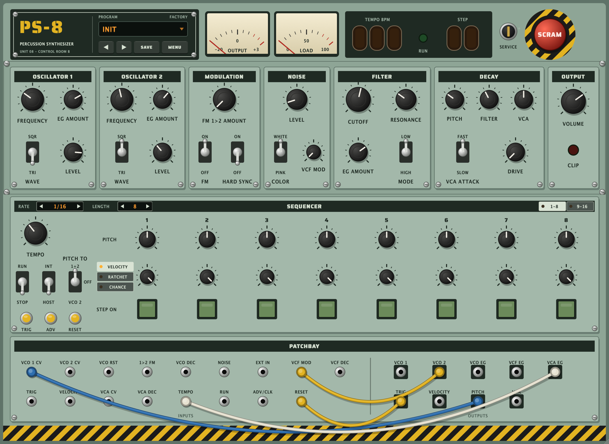
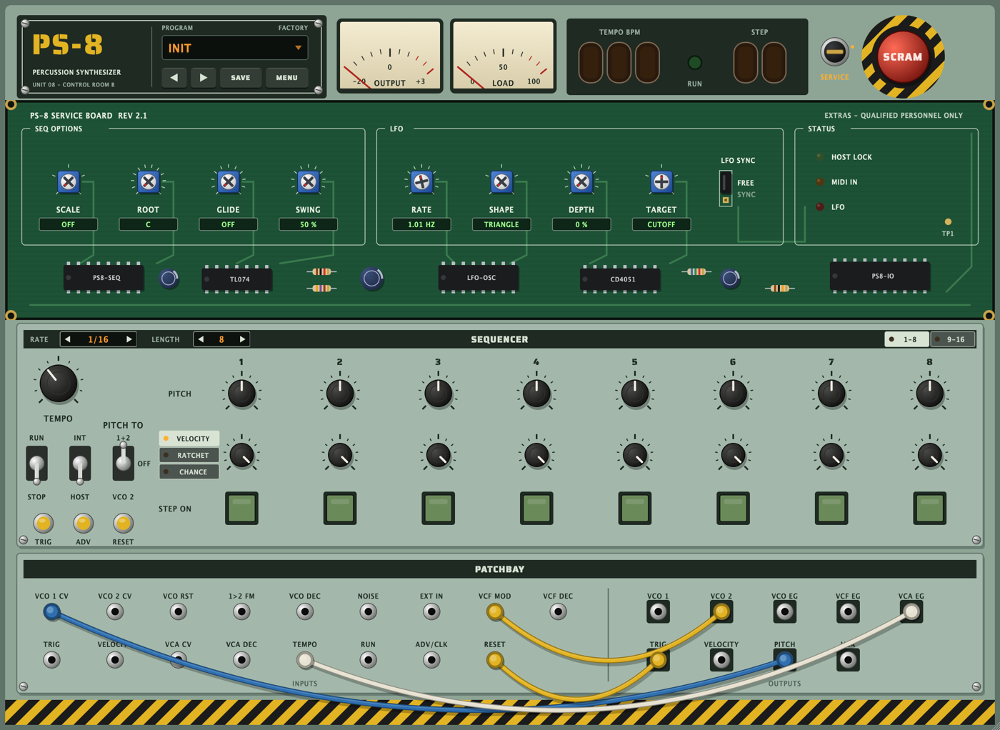

# PS-8

Analog-style semi-modular percussion synthesizer with a step sequencer, in a 1970s
control-room look. Built with JUCE as AU, VST3, CLAP and Standalone for macOS, Windows and Linux.

- Two VCOs (triangle/square) with pitch envelope, linear FM 1→2 and hard sync, white/pink noise
- 4-pole ladder filter (low/high pass) with envelope and noise modulation
- Three decay envelopes (pitch, filter, VCA) with fast/slow VCA attack, drive
- Step sequencer (1–16 steps) with pitch, velocity, ratchet (1–4 hits) and chance per step, steps
  switchable on/off
- Extras under the hood: unscrew the module row to reach a service board with pitch quantiser
  (chromatic, major, minor, pentatonic on any root), glide, swing and an LFO (5 shapes, free or
  host-synced) on pitch, VCO 2, cutoff, FM or volume
- Internal tempo or locked to the host's bar position, 1/4 … 1/32 incl. triplets
- MIDI: play single steps, advance, retrigger and reset by note
- Patchbay with 26 jacks: re-route envelopes, oscillators, sequencer clock, run and reset by cable;
  feedback and audio-rate patches allowed, DAW side-chain into EXT IN
- Presets: 14 factory presets, save your own (incl. cables) as plain files in your user folder;
  the window size is remembered
- SCRAM button: stops the sequencer and silences the voice
- Oversampled (4× up to 48 kHz, 2× up to 96 kHz)

**Manual:** [English](docs/Manual.md) · [Deutsch](docs/Handbuch.md) · **Schnellstart (German quick start):** [docs/Schnellstart.md](docs/Schnellstart.md)

## Download

Released versions are under **Releases**: AU (macOS), VST3, CLAP and a Standalone app for macOS,
Windows and Linux.
Installation is explained in the manual ([English](docs/Manual.md#1-installation) ·
[Deutsch](docs/Handbuch.md#1-installation)).

**macOS:** the plugins are not notarized by Apple yet, so macOS may block them. The manual explains
how to unblock any downloaded plugin – and PS-8 in one go
([English](docs/Manual.md#unblocking-plugins-on-macos) · [Deutsch](docs/Handbuch.md#plugins-auf-macos-freigeben)).

## Credits

Idea, direction, ears and the "nah, take the red caps off" calls: [sscheppert-blip](https://github.com/sscheppert-blip).
Every line of code, DSP and documentation was typed by [Claude Code](https://claude.com/claude-code)
running **Claude Opus 5.5** on **medium effort**. So if you like it, send a good part of the flowers to
the robot – the human only pointed and said "make it go boom". 🤖💐

## License

Public domain ([Unlicense](LICENSE)) – do whatever you like with it, no credit needed.
The plugins are built with [JUCE](https://juce.com), which has its own license terms. The panel font
[Saira Stencil One](design/fonts) is under the SIL Open Font License (design/fonts/OFL.txt).

Building from source: [docs/Development.md](docs/Development.md)
